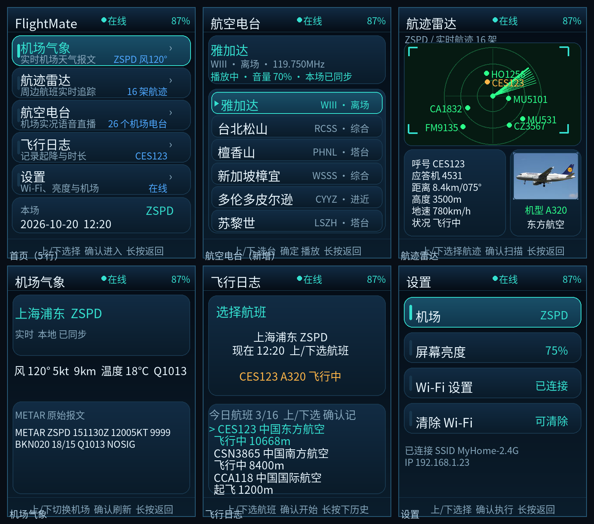
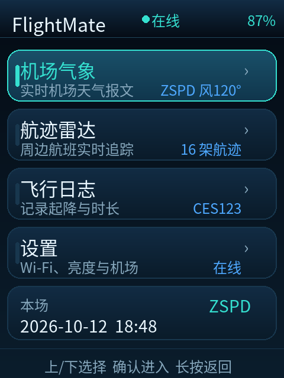
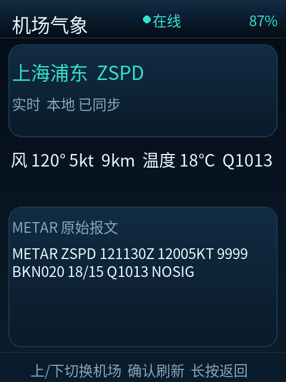
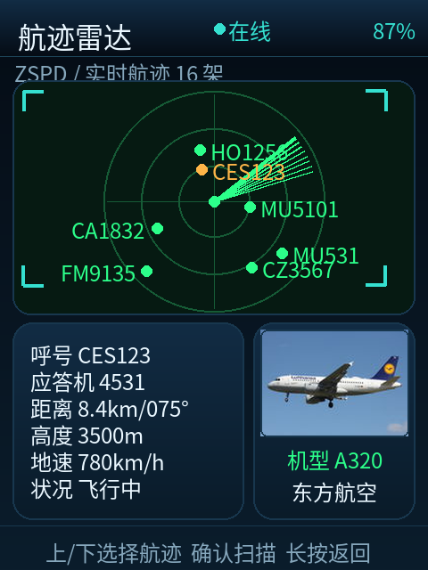
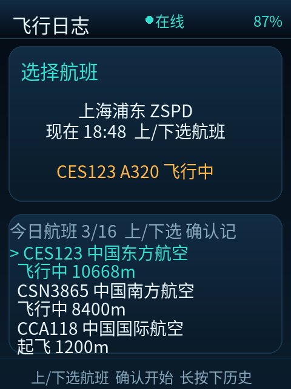
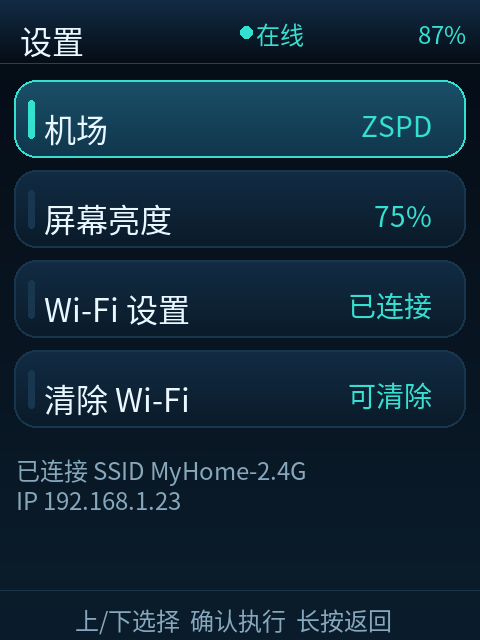
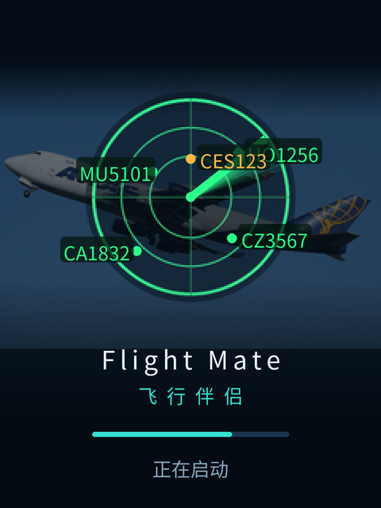

# Flight Mate Pro



**Flight Mate Pro** 把 FoloToy AI Passport 变成一台随身航空助手：机场气象、实时航迹雷达、航空波段电台和飞行日志，全部塞进一块 240×320 的小屏幕里。

[中文](#中文) | [English](#english)

---

## 中文

### 这个版本能做什么

- **机场气象**：读取机场实时 METAR，显示风向、风速、能见度、温度、露点和 QNH，并保留原始报文。
- **航迹雷达**：以本场为中心扫描周边航班，显示呼号、距离、高度、速度、航向和机型；支持查看飞机照片。
- **航空电台**：内置 **29 个频道**，覆盖 **20 个机场**，包含塔台、进近、通播、综合和地面席位。选择频道后按确认键播放/停止，长按上/下键调整音量 ±10；开始播放时会把“本场”同步到所选机场，雷达和气象随之切换。
- **飞行日志**：记录航班、起降机场、飞行时长和暂停时间，日志保存在设备本地。
- **设置**：切换机场、屏幕亮度、Wi-Fi 配网、清除 Wi-Fi。
- **界面与启动动画**：深色航空仪表风格、卡片式布局、雷达 HUD、飞机照片和约 1.7 秒的开机动画。

> 本仓库包含完整应用源码和可刷写的合并固件。当前发布版本为 **2026.10.20**。

### 界面

| 首页 | 机场气象 | 航迹雷达 |
| --- | --- | --- |
|  |  |  |

| 飞行日志 | 设置 | 开机动画 |
| --- | --- | --- |
|  |  |  |

### 按键

| 页面 | 上 / 下 | 确认 | 长按确认 | 长按上 / 下 |
| --- | --- | --- | --- | --- |
| 首页 | 选择功能 | 进入 | 返回首页 | — |
| 机场气象 | 切换机场 | 刷新报文 | 返回首页 | — |
| 航迹雷达 | 切换航班 | 重新扫描 | 返回首页 | — |
| 航空电台 | 选择频道 | 播放 / 停止 | 返回首页（停止播放） | 音量 −10 / +10 |
| 飞行日志 | 选择航班 / 到达机场 | 开始记录 / 结束并保存 | 返回首页 | 长按上：暂停/继续或删除；长按下：取消或查看历史 |
| 设置 | 选择项目 | 执行 | 返回首页 | — |

### 刷机

**适用硬件**：FoloToy AI Passport（ESP32-C3，8 MB Flash，240×320 显示屏，ES8311 音频）。请确认设备与固件匹配。

1. 下载 [`firmware/FlightMatePro-20261020-merged.bin`](firmware/FlightMatePro-20261020-merged.bin)。
2. 校验 SHA-256：

   ```text
   b8c39b60dc835c8713a35065d06f9833c38957343269349dace462ecf49c06c3
   ```

3. 用 esptool 从 `0x0` 写入：

   ```bash
   python -m esptool --chip esp32c3 --port COM19 --baud 460800 \
     write_flash --flash_mode dio --flash_freq 80m --flash_size 8MB \
     0x0 firmware/FlightMatePro-20261020-merged.bin
   ```

   把 `COM19` 换成设备实际串口。Linux/macOS 下对应 `/dev/ttyACM0` 或 `/dev/tty.usbmodem*`。

4. 刷写完成后设备会自动重启。首次启动如未配网，进入「设置 → Wi-Fi 设置」完成配网。

> **注意**：合并镜像从 `0x0` 开始写入，会覆盖包括 NVS 在内的整片 Flash。Wi-Fi 配置、亮度和本地飞行日志会被清除；升级前请自行记录需要保留的设置。

更完整的刷机与排错说明见 [`docs/FLASHING.md`](docs/FLASHING.md)。

### 首次配网

1. 首页进入「设置」→「Wi-Fi 设置」。
2. 设备开启热点 `FlightMate-Setup`，密码 `flightmate`。
3. 手机连接该热点，浏览器打开 `http://192.168.4.1`。
4. 输入 2.4 GHz Wi-Fi 的 SSID 和密码并保存。
5. 屏幕显示「已连接 + IP」即配网成功；失败时可按确认键重试，或按下键清除后重新配置。

### 从源码构建

需要 **ESP-IDF 5.5.3**。

```bash
idf.py set-target esp32c3
idf.py build
idf.py merge-bin
```

合并镜像输出到 `build/FoloToy-AI-Passport-full.bin`。依赖由 ESP-IDF Component Manager 根据 `dependencies.lock` 自动拉取。构建后可运行仓库自带的检查脚本：

```bash
python tools/verify_firmware.py build
python tools/check_no_efuse_write.py build
python tools/check_no_efuse_write.py build/bootloader
```

### 发布版本

| 版本 | 日期 | 内容 |
| --- | --- | --- |
| `2026.10.20` | 2026-10-20 | 新增台北松山、檀香山、新加坡樟宜、雅加达、多伦多皮尔逊 5 个频道；补齐机场坐标；低采样率流改用 minimp3，12 kHz 及以上使用 Helix；音频任务空闲 5 秒自动释放内存；照片链路增加代理重试。 |
| `2026.10.15` | 2026-10-15 | 首次加入航空电台、26 个内置频道、本场同步和双 MP3 解码器。 |

**固件校验**

- 合并镜像：2,007,424 字节
- 应用镜像：1,941,888 字节
- SHA-256：`b8c39b60dc835c8713a35065d06f9833c38957343269349dace462ecf49c06c3`

### 已知限制

- 航空电台只支持前台播放；离开电台页面会立即停止并归还解码器内存。
- AI Passport 没有 PSRAM，HTTPS、音频解码器和飞机照片共享内存。连续内存不足时，固件会先释放照片缓冲再联网。
- 电台依赖 LiveATC 等第三方公开流，频道可用性会随提供方变化；无信号时会提示「该频道暂无信号，换一个试试」。
- 天气、航班和照片接口都有第三方限流；长时间运行和弱网重连仍建议自行观察。
- 本项目不写入 eFuse，不修改芯片一次性配置；仓库内提供 `tools/check_no_efuse_write.py` 做构建期检查。

### 数据与第三方服务

- 航班与航迹：adsb.lol
- 机场气象：AviationWeather.gov
- 飞机照片：Planespotters / airport-data，失败时走图片代理
- 航空语音：LiveATC 公开流。**LiveATC 条款仅允许个人收听，禁止再分发或转售。**

固件不包含任何 API Key 或账号凭据。

### 许可与致谢

本项目基于 [FoloToy AI Passport](https://gitee.com/FoloToy/ai-passport)（MIT License）开发，保留上游版权声明。Flight Mate Pro 的应用层、界面、航空电台和飞行日志改动由 **askachao2026** 完成。

MP3 解码使用 [minimp3](https://github.com/lieff/minimp3)（CC0）和 Helix MP3（RPSL/RCSL，许可证随组件提供）。详见 [`NOTICE.md`](NOTICE.md) 和 [`LICENSE`](LICENSE)。

---

## English

**Flight Mate Pro** turns the FoloToy AI Passport into a pocket aviation companion: airport weather, a live traffic radar, an airband radio, and a flight log on a 240×320 display.

### Highlights

- Live METAR weather with wind, visibility, temperature, dew point and QNH.
- ADS-B traffic radar centred on the selected airport, with callsign, distance, altitude, speed, heading and aircraft photo.
- **29 built-in airband channels** across **20 airports** (tower, approach, ATIS, general and ground positions), streamed from public LiveATC feeds.
- Local flight log with departure/arrival airport, duration and pause time.
- Wi-Fi provisioning through the `FlightMate-Setup` hotspot.
- No eFuse writes; a build-time guard checks the final image.

### Flash

Download [`firmware/FlightMatePro-20261020-merged.bin`](firmware/FlightMatePro-20261020-merged.bin) and write it at `0x0`:

```bash
python -m esptool --chip esp32c3 --port COM19 --baud 460800 \
  write_flash --flash_mode dio --flash_freq 80m --flash_size 8MB \
  0x0 firmware/FlightMatePro-20261020-merged.bin
```

SHA-256: `b8c39b60dc835c8713a35065d06f9833c38957343269349dace462ecf49c06c3`

The merged image overwrites the whole flash, including NVS settings and logs.

### Build

ESP-IDF 5.5.3:

```bash
idf.py set-target esp32c3
idf.py build
idf.py merge-bin
```

The merged image is written to `build/FoloToy-AI-Passport-full.bin`.

### License

MIT. Based on [FoloToy AI Passport](https://gitee.com/FoloToy/ai-passport). See [`LICENSE`](LICENSE) and [`NOTICE.md`](NOTICE.md).

LiveATC streams are for personal listening only and must not be redistributed or resold.


